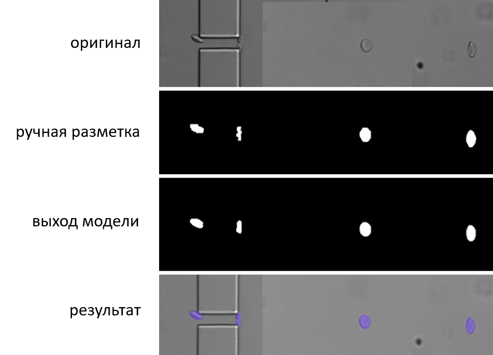
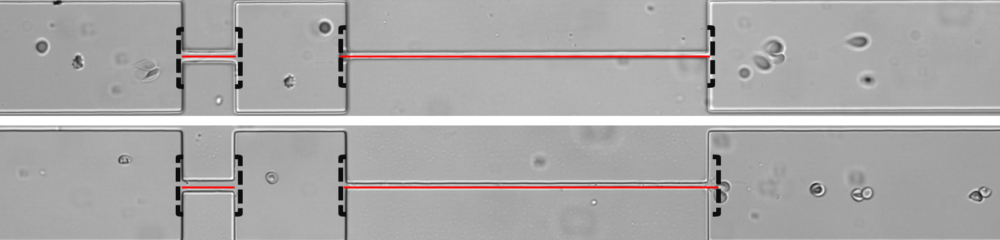
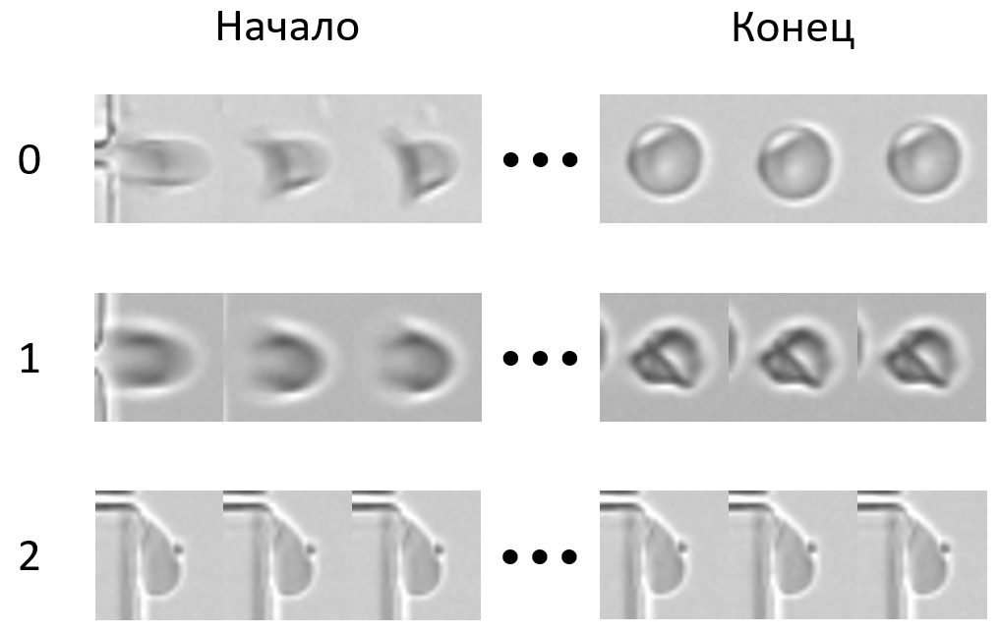

# ErythroFlowAI

Пайплайн автоматического анализа видео с эритроцитами в микроканале:
сегментация кадров нейросетью U-Net, трекинг клеток, детекция границ
микроканала, оценка скоростей входа/выхода и классификация траекторий
LSTM+CNN. В комплекте — графический интерфейс для пакетной обработки папок
с видео, рассчитанный на нетехнических пользователей.

## Возможности

- **Сегментация** кадров 160×1920 (U-Net, 1 канал)
- **Трекинг** клеток по ближайшему соседу с проверкой площади
- **Детекция границ** микроканала (морфологический градиент + DBSCAN)
- **Оценка скоростей** прохождения микроканала с фильтрацией выбросов
- **Классификация траекторий** по последовательностям патчей 31×31
  (LSTM+CNN, 3 класса: `relaxed`, `not relaxed`, `outlets`)
- **Пакетная обработка** папки с видео через графический интерфейс
- **Выбор формата кадров** (`.tif`, `.png`, `.jpeg`), по умолчанию `.tif`

## Примеры работы

### Сегментация



Нейросеть выделяет клетки на каждом кадре; маски используются для трекинга
и вычисления площадей.

### Локализация каналов



Границы микроканала и выравнивающего канала определяются автоматически
по препарату морфологического градиента изображения и кластеризации кумулятивного градиента по столбцам.

### Классы траекторий



| Класс | Описание |
|---|---|
| `0 — relaxed` | Клетки, вернувшие нормальную форму |
| `1 — not relaxed` | Клетки, оставшиеся деформированными |
| `2 — outlets` | Залипшие клетки, различный мусор |

## Установка

### 1. CUDA-версия PyTorch

PyTorch в PyPI по умолчанию — CPU-сборка. Чтобы задействовать GPU,
установите CUDA-версию отдельно, выбрав индекс под драйвер вашей системы
(`cu118` — CUDA 11.8, `cu126` — CUDA 12.6):

```bash
pip install torch torchvision --index-url https://download.pytorch.org/whl/cu126
```

Проверка:

```bash
python -c "import torch; print(torch.cuda.is_available())"
```

Должно вывести `True`.

### Установка (готовый установщик)

Скачайте последнюю версию установщика: [ErythroFlowAI_Setup.exe](https://github.com/AlexanderSIv/ErythroFlowAI/releases/latest)

*Установщик не требует наличия Python, CUDA Toolkit или интернета. Достаточно драйвера NVIDIA.*

### 2. Остальные зависимости

```bash
pip install -r requirements.txt
```

### 3. Веса моделей

Файлы `unet.safetensors` и `cnnlstm.safetensors` положите в папку `weights/`.
Их можно получить у автора или на Hugging Face по [ссылке](https://huggingface.co/AlexanderIvS/ErythroFlowAI_models).

>Для установки CPU версии вместо шага 1 введите команду `pip install torch torchvision`. 

## Запуск

```bash
python app.py
```

В открывшемся окне **ErythroFlowAI**:

1. Нажмите **«Выбрать папку»** и укажите папку, внутри которой лежат
   подпапки с кадрами (каждая подпапка — одно видео).
2. Выберите **формат кадров** (`.tif`, `.png`, `.jpeg`). По умолчанию `.tif`.
3. Нажмите **«Запустить»**.
4. Дождитесь сообщения об успешном завершении.
5. Нажмите **«Завершить работу»**.

Верхний прогресс-бар показывает, что текущее видео обрабатывается,
нижний — общий прогресс по видео в выбранной папке.

## Результаты

Для каждого видео создаётся папка `outputs/<эксперимент>/<образец>/`:

```
outputs/<эксперимент>/<образец>/
├── output.csv            # траектории: id, кадр, координаты, площадь,
│                         # тип траектории, скорости, класс (relax_class)
├── v.csv                 # нормированные скорости прохождения микроканала
└── class_summary.txt     # сводка по классам траекторий
```

Структура выходных папок повторяет структуру входных, поэтому результаты
разных видео не перезаписывают друг друга.

Временные файлы (маски U-Net, патчи траекторий) хранятся в `temp/` и
удаляются автоматически после завершения обработки каждого видео.

## Системные требования

### Минимальные

- **CPU:** Многоядерный CPU с поддержкой AVX-инструкций
- **RAM:** 16 GB RAM
- **OS:** Windows 10 и новее
  
> Работоспособность на слабом CPU возможна, но время обработки одного
> видео может достигать нескольких часов и более.

### Рекомендуемые

- **CPU:** Intel Core i5-9400 и выше, AMD Ryzen 5 1600 и выше
- **GPU:** с поддержкой CUDA, от 6 GB VRAM, поколения GTX 10xx и новее
- **RAM:** 16 GB и выше
- **OS:** Windows 10 и новее

> Данное ПО оптимизировано под полную нагрузку современных систем.
> Убедитесь, что ваша система проходит OCCT Power Test или аналогичный
> стресс-тест без перегревов и вылетов. Для GPU поколения RTX 30xx и новее
> с термодатчиками на VRAM рекомендуется дополнительно проверить
> температуры памяти в OCCT VRAM Test или аналогах.

## Требования к данным

- **Разрешение:** близкое к нативному для указанной модели (160×1920) или как минимум с тем же соотношением сторон (при кратно отличающемся разрешении качество сегментации может значительно снижаться!).
- **Топология микрофлюидного устройства:** как на примерах или схожая, для других топологий может потребоваться дообучение модели.
- **Изображения:** в форматах .tif, .png или .jpeg. Цветные изображения будут приведены к grayscale при импорте.

## Лицензия

PolyForm Noncommercial 1.0.0 — см. `LICENSE`.

Required Notice: Copyright (c) 2026 Alexander Ivanov (github.com/AlexanderSIv)

Для коммерческого использования требуется отдельная лицензия.
Контакт: `a.s.ivanov@mail.ru`.
